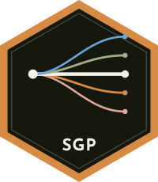
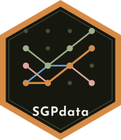
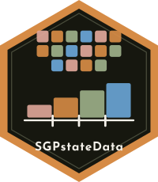
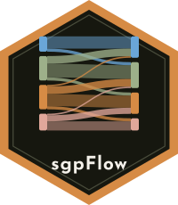

<picture>
  <source media="(prefers-color-scheme: dark)" srcset="assets/banner-dark.svg">
  
</picture>

  <a href="https://dbetebenner.github.io/"><b>Website</b></a> ·
  <a href="https://dbetebenner.github.io/talks/"><b>Talks</b></a> ·
  <a href="https://dbetebenner.github.io/papers/"><b>Papers</b></a> ·
  <a href="https://sgp.io/"><b>sgp.io</b></a> ·
  <a href="https://www.nciea.org/about-us/team/consultant/damian-betebenner"><b>Center for Assessment</b></a>

I work on how we describe student learning over time. I developed the student growth percentile (SGP)
methodology, and I maintain the open-source R packages that states use to calculate and report student growth.
At the [Center for Assessment](https://www.nciea.org) I work with state education agencies on growth and
accountability systems, technical advisory committees, and on reporting results so that educators and the public
can use them.

### What I'm working on

- **Longitudinal inference without longitudinal data.** A copula-based framework that recovers growth from
  cross-sectional assessment data, and brings TAMP and SGP under one roof.
- **Measurement as an AI-native profession.** How assessment work changes when AI is part of every step, from
  analysis to the dissertation. I built [dataimago](https://github.com/dataimago/dataimago), the design system and
  R tooling behind my recent sites and decks, along the way.
- **Growth in practice.** Annual SGP analyses and reporting with states, and how English-learner exit decisions
  relate to growth.

### R packages

  
  
  
  
  
  

| Package | What it does | |
|---|---|---|
| [SGP](https://sgp.io/) | Student growth percentiles and percentile growth projections and trajectories |  |
| [SGPdata](https://centerforassessment.github.io/SGPdata/) | Exemplar longitudinal data sets for SGP |  |
| [SGPstateData](https://centerforassessment.github.io/SGPstateData/) | The state-level metadata SGP runs on: cut scores, knots and boundaries, norm-group preferences | GitHub |
| [sgpFlow](https://github.com/dbetebenner/sgpFlow) | Growth trajectories and student flow from SGP coefficient matrices | GitHub |
| [randomNames](https://centerforassessment.github.io/randomNames/) | Random gender- and ethnicity-specific names |  |
| [toOrdinal](https://centerforassessment.github.io/toOrdinal/) | Ordinal numbers and dates in several languages |  |

### Recent talks

<!-- talks:start -->
<table>
<tr>
<td width="33%" valign="top">
 
<b><a href="https://dbetebenner.github.io/talks/2026-10-26-student-growth-the-pulse-of-the-education-system/">Student Growth: The Pulse of the Education System</a></b> 
DoWEA Fall Leadership Meeting · Oct 26, 2026
</td>
<td width="33%" valign="top">
 
<b><a href="https://dbetebenner.github.io/talks/2026-10-19-new-hampshire-2026-sgp-results/">New Hampshire 2026 SGP Results</a></b> 
New Hampshire Technical Advisory Committee · Oct 19, 2026
</td>
<td width="33%" valign="top">
 
<b><a href="https://dbetebenner.github.io/talks/2026-10-07-educational-measurement-as-an-ai-native-profession/">Educational Measurement as an AI-Native Profession</a></b> 
AIME-Con 2026, Pittsburgh · Oct 7, 2026
</td>
</tr>
</table>

- [Writing an AI-Native Dissertation](https://dbetebenner.github.io/talks/2026-10-05-writing-an-ai-native-dissertation/) — AIME-Con 2026, Pittsburgh, Oct 2026
- [Rhode Island 2026 SGP Analyses](https://dbetebenner.github.io/talks/2026-08-27-rhode-island-2026-sgp-analyses/) — Rhode Island Technical Advisory Committee, Aug 27, 2026
- [Longitudinal Insight from Cross-Sectional Assessments](https://dbetebenner.github.io/talks/2026-08-18-longitudinal-insight-from-cross-sectional-assessments/) — IEA Research & Development, Aug 18, 2026
- [What Am I Actually Doing?](https://dbetebenner.github.io/talks/2026-07-15-what-am-i-actually-doing/) — Center for Assessment staff retreat (brown-bag), Jul 15, 2026

[All 411 talks →](https://dbetebenner.github.io/talks/)
<!-- talks:end -->

<picture>
  <source media="(prefers-color-scheme: dark)" srcset="assets/timeline-dark.svg">
  
</picture>

The banner, the talk timeline and the recent talks are drawn by <a href="tools/build.mjs"><code>tools/build.mjs</code></a>
from the catalog behind my website, and a weekly workflow keeps them current.
